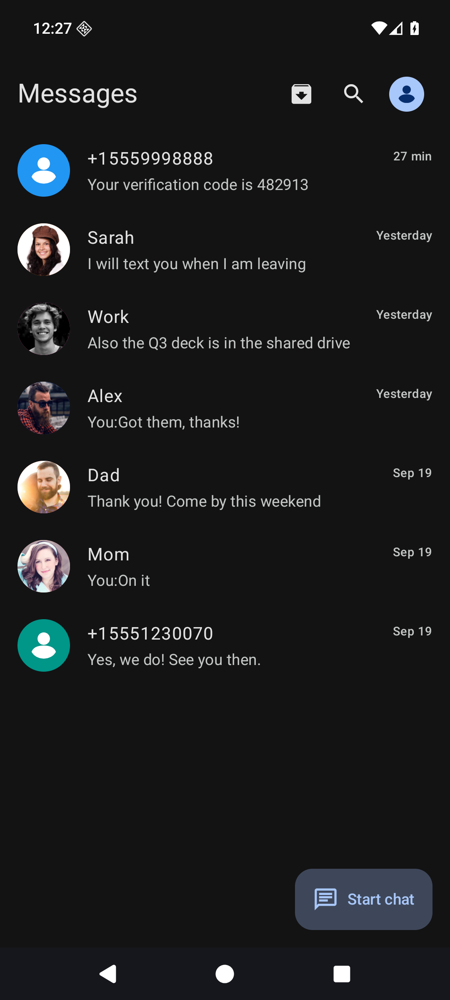
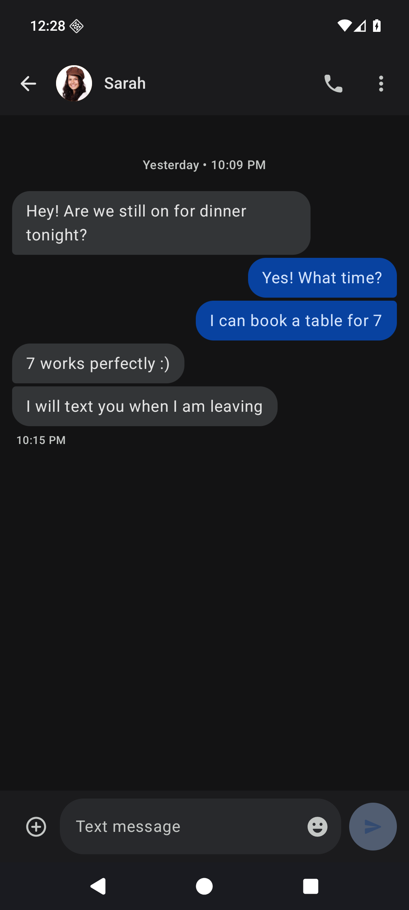
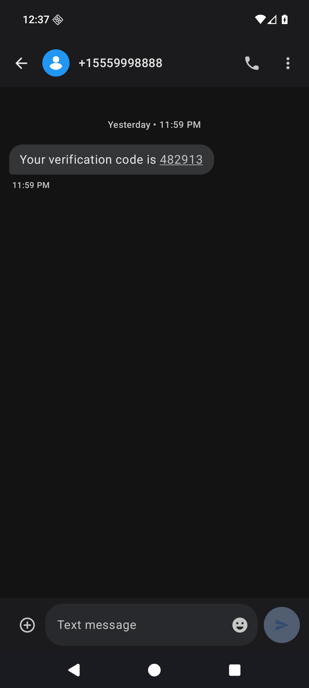
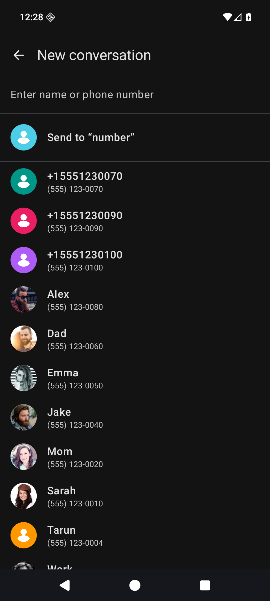
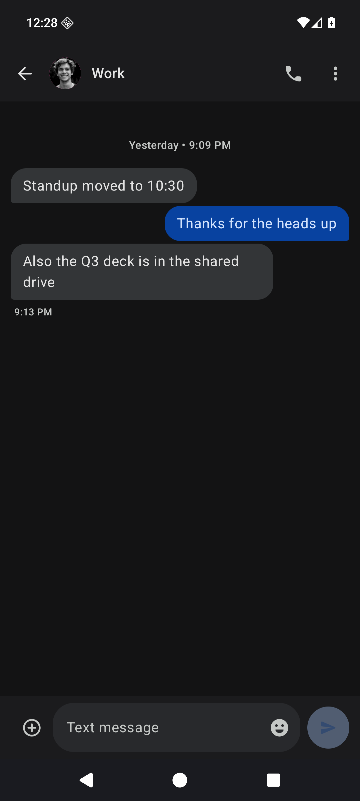
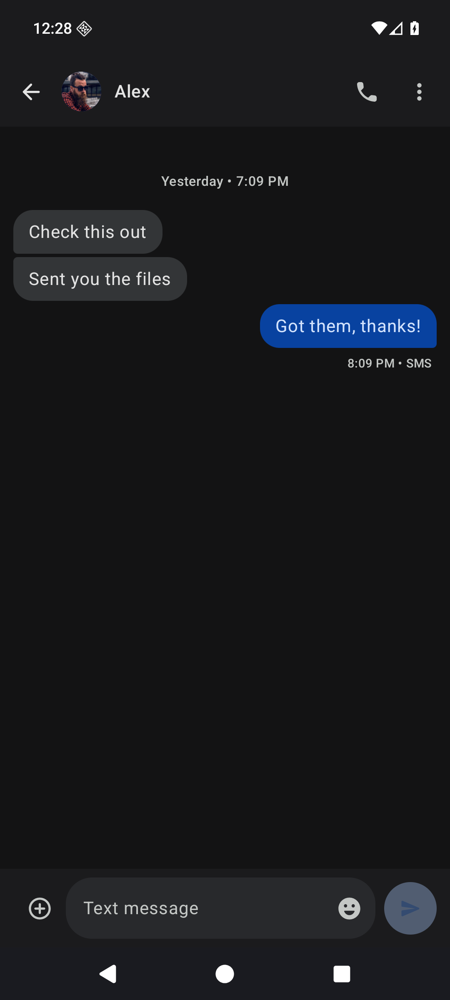
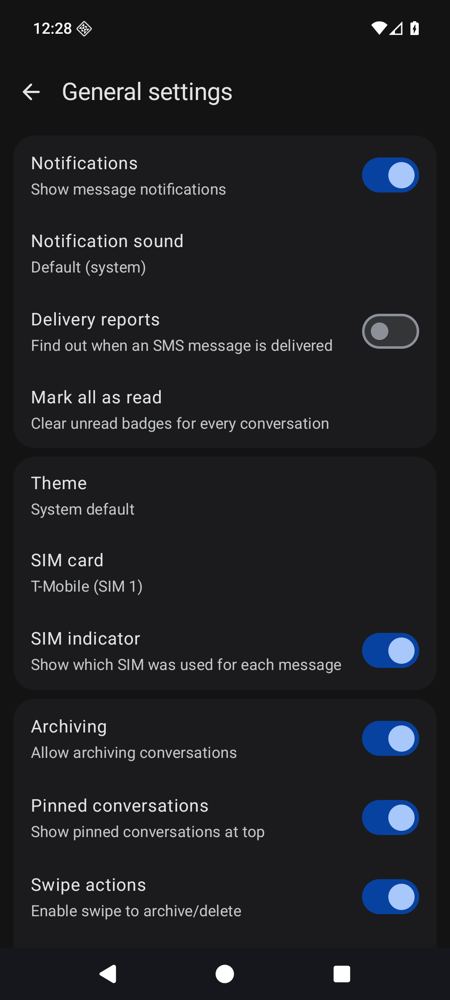

<p align="center">
  
</p>

<h1 align="center">Govind SMS</h1>

> Maintained by **Shri Govind Jangra** — a modified version of [Messages](https://github.com/an1ndra/Messages) by **an1ndra** (GPL-3.0). See [Credits](#credits--attribution).

Simple, private SMS messaging. Offline-first, no ads, no tracking.

Built with **Kotlin + Jetpack Compose + Material 3 (M3)**. No internet permission — everything is local SMS + local database.

## ⚠️ Keep Android Open — Important

> **Unless you oppose it, Google will lock down Android in 2027** — silencing independent
> developers, F-Droid, and open-source distribution worldwide, with no opt-out [keepandroidopen.org](https://keepandroidopen.org).

## Features

- **Real SMS + MMS**: Send/receive SMS with multi-SIM support; imports and displays MMS (text + photos) from the system provider
- **Google Messages UI**: Material 3 design, dark/light themes, conversation avatars, animated message bubbles
- **Backup & Restore**: PIN-encrypted backup/restore with a chosen save location (including external SD cards)
- **Message Management**: Pin, archive, delete, block numbers, trash with 30-day auto-purge
- **Drafts**: Auto-save drafts, restore on conversation open
- **Scheduled Messages**: Long-press send to schedule messages with DatePicker + TimePicker
- **Quick Reply**: Reply directly from notifications
- **Message Lock**: Biometric-protect sensitive messages
- **OTP Highlighting**: One-time passwords automatically highlighted in blue
- **Contact Photos**: Loads real contact profile pictures
- **Delayed Sending**: Configurable delay before sending messages
- **Work Profile Contacts**: Search contacts in both the personal and work (managed) profile; work contacts are shown with a briefcase badge in the picker, home list, and chat header
- **Accessibility Mode**: TalkBack descriptions, high-contrast themes, larger text and touch targets, and reduced motion

## Screenshots

| Conversations | Grouped bubbles | OTP highlighting | New chat |
|---|---|---|---|
|  |  |  |  |

| Work chat | Alex chat | Settings |
|---|---|---|
|  |  |  |

## Download

Get the latest signed APK from [GitHub Releases](https://github.com/sintujangra20/sms/releases/latest). Every release includes a SHA-256 file, `build-info.json` and a signed build-provenance attestation (`.attestation.json`). To check that an APK was built from this source code:

```
gh attestation verify Govind-SMS-v1.0.0.apk --repo sintujangra20/sms
```

## Requirements

- Android 10 (API 29) or higher
- SMS/MMS permissions (send, receive, read, MMS/WAP push)
- Contact permission (READ_CONTACTS)
- Notification permission (Android 13+), phone state (dual-SIM), and photo access (attachments)
- No internet permission

## Technical Details

- **Package**: `shri.govind.sms` (Govind SMS)
- **Min SDK**: 29 (Android 10)
- **Compile / Target SDK**: 36 (Android 16)
- **Database**: SQLite with Flow-based reactive queries
- **Architecture**: Single-Activity, manual `navRoute` state (no Navigation-Compose)

## License

This project is licensed under the GNU General Public License v3.0 - see the [LICENSE](LICENSE) file for details.

Original work: (C) an1ndra. Modifications (Govind SMS): (C) 2026 Shri Govind Jangra, under the same GPL-3.0 terms. See [NOTICE.md](NOTICE.md) for the list of changes.

## Credits & Attribution

- **Govind SMS** is maintained by **Shri Govind Jangra** ([@sintujangra20](https://github.com/sintujangra20)).
- It is a modified version of **[Messages](https://github.com/an1ndra/Messages)** by **an1ndra**, released under the GNU GPL v3. The original author's work and copyright remain theirs; thank you.
- Changes made in October 2026:
  - renamed to **Govind SMS** (`shri.govind.sms`), version numbering restarted at 1.0.0;
  - new green + orange colour theme (replaces the original blue) and a new launcher icon;
  - "Copy code" action on OTP notifications that dismisses the notification and marks the thread read;
  - multi-select, select-all, bulk archive and bulk delete in the conversation list;
  - new GitHub Actions build-and-release workflow with build-provenance attestation.
- The app icon artwork (Krishna ji) is an AI-generated image supplied by the maintainer.
- The MMS stack comes from the vendored `android-smsmms` module (see its README).
- See [NOTICE.md](NOTICE.md).

## Contributing

Issues and pull requests: https://github.com/sintujangra20/sms/issues . See [docs/Developer.md](docs/Developer.md) for development setup instructions.
